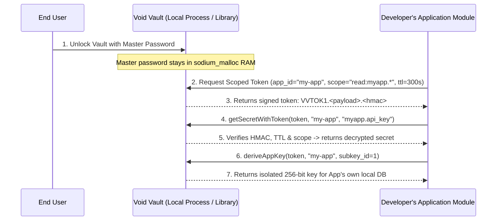

# Void Vault Developer & Integration Guide

This guide explains how software developers can embed **Void Vault** into their own applications (desktop apps, trading bots, AI agents, CLI tools, healthcare/fintech apps, and local microservices) so that:

1. **Clients own their sensitive data locally** inside an Argon2id + XChaCha20-Poly1305 AEAD container (`vault_data.dat`).
2. **Your application modules never need to store or handle the user's master password**, using **"Sign in with Void Vault"** scoped capability tokens (`VVTOK1`) and zero-knowledge derived app subkeys.

---

## Table of Contents

1. [Core Concepts: How "Sign in with Void Vault" Works](#1-core-concepts-how-sign-in-with-void-vault-works)
2. [Capability Token Scopes Reference](#2-capability-token-scopes-reference)
3. [Option 1: Python SDK (`sdk/python/void_vault.py`)](#3-option-1-python-sdk-sdkpythonvoid_vaultpy)
4. [Option 2: Language-Agnostic `--broker` IPC Protocol (Node.js, Go, Rust, C#)](#4-option-2-language-agnostic---broker-ipc-protocol-nodejs-go-rust-c)
5. [Option 3: Universal C ABI (`include/void_vault_c.h`)](#5-option-3-universal-c-abi-includevoid_vault_ch)
6. [Option 4: Native C++20 Library (`VaultBroker`)](#6-option-4-native-c20-library-vaultbroker)
7. [Security Best Practices for Integrators](#7-security-best-practices-for-integrators)

---

## 1. Core Concepts: How "Sign in with Void Vault" Works



- **Encrypted Multi-Secret Container (`VVKV1`):** All named secrets (`key -> value`) are packed together and encrypted as a single XChaCha20-Poly1305 AEAD ciphertext. Key names and secret counts are never visible on disk.
- **Scoped Capability Tokens (`VVTOK1`):** Signed with a vault-internal 256-bit key via `HMAC-SHA512256`. Bound to a specific `app_id`, `scope`, and expiration timestamp (`expires_at`).
- **Zero-Knowledge App Subkeys (`deriveAppKey`):** Uses `libsodium`'s BLAKE2b KDF (`crypto_kdf_derive_from_key`) to derive deterministic 256-bit keys isolated per `app_id` and `subkey_id`. Your app can encrypt its own SQLite database or files without ever knowing the user's master password.

---

## 2. Capability Token Scopes Reference

When calling `issueToken(app_id, scope, ttl_seconds)`, use the narrowest scope your module needs:

| Scope String | Read Permission | Write Permission | Typical Use Case |
|---|---|---|---|
| `auth:only` | None | None | Identity verification ("Sign in") + `deriveAppKey` only |
| `read_key:<exact_key>` | Only `<exact_key>` | None | Module only needs to read a single credential (e.g. `read_key:openai.api_key`) |
| `key:<exact_key>` | Only `<exact_key>` | Only `<exact_key>` | Module manages a single secret (e.g. `key:oauth.refresh_token`) |
| `read:<prefix>*` | Keys starting with `<prefix>` | None | Read-only access to an app's namespace (e.g. `read:trader.*`) |
| `write:<prefix>*` | Keys starting with `<prefix>` | Keys starting with `<prefix>` | Full read/write access within an app's namespace (e.g. `write:trader.*`) |
| `read:*` | All keys | None | Backup / audit reader |
| `*` | All keys | All keys | Full administrative session |

---

## 3. Option 1: Python SDK (`sdk/python/void_vault.py`)

The Python SDK has **zero external dependencies** (uses only the Python standard library) and communicates with `void_vault --broker` over an unbuffered stdin/stdout pipe.

### Quickstart Example

```python
from pathlib import Path
from sdk.python.void_vault import VoidVaultClient, VoidVaultError

VAULT_EXE = Path("void_vault.exe")  # or "./void_vault" on Linux
VAULT_DIR = Path("./user_vault_data")
VAULT_DIR.mkdir(exist_ok=True)

with VoidVaultClient(VAULT_EXE, data_dir=VAULT_DIR, kdf_profile="interactive") as vault:
    # 1. First-time account initialization (only run once when creating a new vault)
    if not (VAULT_DIR / "vault_auth.dat").exists():
        vault.setup_account("ClientMasterPass#2026!")

    # 2. Unlock the vault
    vault.unlock("ClientMasterPass#2026!")

    # 3. Store namespaced secrets
    vault.set_secret("trader.mt5_login", "100200300")
    vault.set_secret("trader.mt5_password", "BrokerSecret!99")
    vault.set_secret("medical.record_key", "Patient-XYZ")

    # 4. Issue a 5-minute read-only token scoped ONLY to "trader.*"
    trader_token = vault.issue_token(
        app_id="void-trader",
        scope="read:trader.*",
        ttl_seconds=300,
    )

    # 5. Verify the token ("Sign in with Void Vault")
    claims = vault.verify_token(trader_token, app_id="void-trader")
    print(f"Authenticated app={claims.app_id}, scope={claims.scope}, expires={claims.expires_at}")

    # 6. Read allowed secrets using the token
    mt5_pw = vault.get_secret_with_token(
        token=trader_token,
        app_id="void-trader",
        key="trader.mt5_password",
    )
    print("Retrieved MT5 password length:", len(mt5_pw))

    # 7. Cross-namespace access is automatically blocked
    try:
        vault.get_secret_with_token(
            token=trader_token,
            app_id="void-trader",
            key="medical.record_key",
        )
    except VoidVaultError as exc:
        print("Cross-namespace access blocked as expected:", exc)

    # 8. Derive a 32-byte (256-bit) encryption key isolated to "void-trader"
    app_db_key: bytes = vault.derive_app_key(
        token=trader_token,
        app_id="void-trader",
        subkey_id=1,
    )
    print("Derived 256-bit app key (hex):", app_db_key.hex())

    # 9. Revoke all issued tokens at any time
    vault.revoke_all_tokens()
```

---

## 4. Option 2: Language-Agnostic `--broker` IPC Protocol (Node.js, Go, Rust, C#)

Any programming language can integrate Void Vault by spawning:
```bash
void_vault --data-dir <path> --kdf <interactive|moderate|sensitive> --broker
```
and sending newline-delimited commands to `stdin` while reading newline-delimited responses from `stdout`.

- **Binary & Special-Character Safety:** Secret values and passwords are **hex-encoded** on the wire so spaces, newlines, or binary bytes never break line framing.
- Every response line begins with either `OK` (followed by optional result data) or `ERR <error_code>`.

### Wire Protocol Command Table

| Request Line (`stdin`) | Success Response (`stdout`) | Description |
|---|---|---|
| `SETUP <hex_password>` | `OK initialized` | Initializes a new vault account |
| `UNLOCK <hex_password>` | `OK unlocked` | Authenticates and unlocks the vault |
| `LOCK` | `OK locked` | Wipes session password and locks the vault |
| `SET_SECRET <key> <hex_value>` | `OK saved` | Stores or updates `<key>` |
| `GET_SECRET <key>` | `OK <hex_value>` | Reads `<key>` (unlocked owner mode) |
| `DELETE_SECRET <key>` | `OK deleted` | Deletes `<key>` |
| `LIST_KEYS` | `OK <k1,k2,...>` | Lists all stored key names |
| `ISSUE_TOKEN <app_id> <scope> <ttl_sec>` | `OK <VVTOK1...>` | Issues a signed capability token |
| `VERIFY_TOKEN <token> <app_id>` | `OK <scope> <expires_at>` | Verifies a token's MAC, expiry, and `app_id` |
| `TOKEN_GET_SECRET <token> <app_id> <key>` | `OK <hex_value>` | Reads `<key>` if `<token>` permits it |
| `TOKEN_SET_SECRET <token> <app_id> <key> <hex_val>` | `OK saved` | Writes `<key>` if `<token>` permits it |
| `DERIVE_APP_KEY <token> <app_id> <subkey_id>` | `OK <64_char_hex_key>` | Derives a 32-byte app-isolated subkey |
| `REVOKE_TOKENS` | `OK revoked` | Rotates internal key, invalidating all tokens |
| `QUIT` | `OK bye` | Locks the vault, wipes RAM, and exits (`0`) |

### Node.js / TypeScript Integration Example

```javascript
import { spawn } from "node:child_process";
import readline from "node:readline";

class VoidVaultBroker {
  constructor(exePath, dataDir = ".") {
    this.proc = spawn(exePath, ["--data-dir", dataDir, "--broker"], {
      stdio: ["pipe", "pipe", "pipe"],
    });
    this.rl = readline.createInterface({ input: this.proc.stdout });
    this.queue = [];
    this.rl.on("line", (line) => {
      const resolve = this.queue.shift();
      if (resolve) resolve(line);
    });
  }

  async send(cmd) {
    const line = await new Promise((resolve) => {
      this.queue.push(resolve);
      this.proc.stdin.write(cmd + "\n");
    });
    if (line.startsWith("ERR ")) throw new Error(line.slice(4));
    return line.startsWith("OK ") ? line.slice(3) : "";
  }

  unlock(password) {
    return this.send(`UNLOCK ${Buffer.from(password, "utf8").toString("hex")}`);
  }

  issueToken(appId, scope = "read:*", ttlSeconds = 300) {
    return this.send(`ISSUE_TOKEN ${appId} ${scope} ${ttlSeconds}`);
  }

  async getSecretWithToken(token, appId, key) {
    const hex = await this.send(`TOKEN_GET_SECRET ${token} ${appId} ${key}`);
    return Buffer.from(hex, "hex").toString("utf8");
  }

  close() {
    return this.send("QUIT");
  }
}
```

---

## 5. Option 3: Universal C ABI (`include/void_vault_c.h`)

For native languages (C, C++, Rust `extern "C"`, Go `cgo`, C# `DllImport`, or MetaTrader 5 MQL5 `#import`), include [`include/void_vault_c.h`](include/void_vault_c.h):

```c
#include "void_vault_c.h"
#include <stdio.h>

int main(void) {
    VoidVaultHandle* vault = vv_open("vault_auth.dat", "vault_data.dat");
    if (!vault) return 1;

    if (!vv_is_initialized(vault)) {
        vv_setup_password(vault, "MyStrongMasterPassword123!");
    }

    if (vv_unlock(vault, "MyStrongMasterPassword123!")) {
        vv_set_secret(vault, "app.api_key", "sk-live-987654321");

        char token[512];
        if (vv_issue_token(vault, "my-c-app", "read:app.*", 300, token, sizeof(token))) {
            char secret[256];
            if (vv_get_secret_with_token(vault, token, "my-c-app", "app.api_key", secret, sizeof(secret))) {
                printf("Retrieved scoped secret successfully.\n");
            }
        }
        vv_lock(vault);
    }

    vv_close(vault);
    return 0;
}
```

---

## 6. Option 4: Native C++20 Library (`VaultBroker`)

If you are building a C++20 application with CMake, link against `void_vault_core` and use `VaultBroker` directly:

```cpp
#include "storage.hpp"
#include "security/auth.hpp"
#include "vault/vault.hpp"
#include "vault/broker.hpp"

int main() {
    Authorizer auth("vault_auth.dat");
    Storage storage("vault_data.dat");
    Vault vault(auth, storage);
    VaultBroker broker(vault);

    if (!auth.isInitialized()) {
        auth.setPassword("CppMasterPassword123!");
    }
    if (vault.authenticate("CppMasterPassword123!") && vault.unlock()) {
        broker.setSecret("billing.stripe_key", "rk_live_example");

        std::string token;
        broker.issueToken("billing-service", "read:billing.*", 300, token);

        std::string value;
        if (broker.getSecretWithToken(token, "billing-service", "billing.stripe_key", value)) {
            // Use `value`, then wipe it from memory when done
        }
        vault.lock();
    }
}
```

---

## 7. Security Best Practices for Integrators

1. **Always Use Namespace Scopes:** Prefix each module's secrets (e.g. `trader.api_key`, `mail.smtp_pass`) and issue tokens scoped only to that prefix (`read:trader.*`).
2. **Keep Token TTLs Short:** Issue tokens with short lifetimes (`60`–`300` seconds) for active operations rather than long-lived tokens.
3. **Never Log Tokens or Secrets:** Treat `VVTOK1...` capability tokens as bearer credentials during their TTL window.
4. **Use `--kdf moderate` or `--kdf sensitive` in Production:** When storing high-value credentials on end-user machines, launch Void Vault with `--kdf moderate` (256 MiB Argon2id) or `--kdf sensitive` (1 GiB Argon2id).
